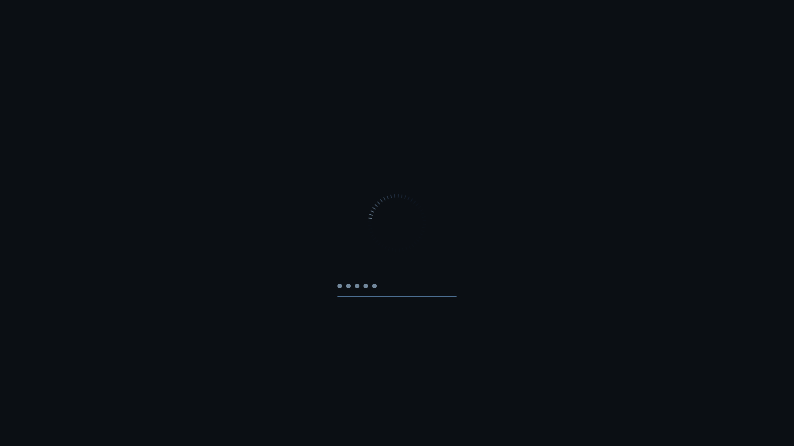
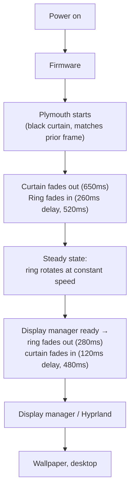

# Obsidian — a Plymouth boot theme for CachyOS

A minimal, dark boot splash: a flat `#0B0F14` field and a single thin ring
indicator, rotating at a constant rate. No logo, no progress bar, no boot
text. Built for CachyOS (Arch), supports both GRUB and systemd-boot
(including CachyOS's `sdboot-manage`), and survives kernel/system updates.


## Contents

```
theme/obsidian/            The Plymouth theme (script plugin)
  obsidian.plymouth         Theme descriptor
  obsidian.script            Animation logic (Plymouth's script language)
  assets/                    Pre-rendered PNGs (ring, dot, solid pixels)
tools/
  render_assets.py           Regenerates theme/obsidian/assets/*.png
  render_preview.py          Regenerates preview/*.png and boot-sequence.gif
lib/                        Installer internals (sourced by bin/*.sh)
  common.sh                  Logging, backups, state file
  bootloader.sh               GRUB / systemd-boot / sdboot-manage detection & config
  mkinitcpio.sh                HOOKS management, theme selection, initramfs rebuild
  verify.sh                    Post-install verification
bin/
  install.sh                  Installs and activates the theme
  uninstall.sh                 Removes the theme, restores prior configuration
tests/
  unit_tests.sh                Function-level tests (no root required)
  e2e_test.sh                  Full install/uninstall runs in a bubblewrap sandbox
preview/                     Rendered preview frames + boot-sequence.gif
```

## Install

```sh
git clone <this-repo> plymouth-obsidian
cd plymouth-obsidian
sudo ./bin/install.sh
```

The installer:

1. Detects your bootloader (GRUB, vanilla Arch systemd-boot, or CachyOS's
   `sdboot-manage`).
2. Installs the `plymouth` package if missing.
3. Copies `theme/obsidian/` to `/usr/share/plymouth/themes/obsidian/`.
4. Sets it as the default theme (`plymouthd.conf`).
5. Inserts the `plymouth` hook into `/etc/mkinitcpio.conf` (correctly
   ordered relative to `systemd`/`udev` and `encrypt`/`sd-encrypt`).
6. Adds `quiet splash loglevel=3 vt.global_cursor_default=0
   rd.udev.log_priority=3` to your kernel command line, without touching
   parameters you already have.
7. Rebuilds the initramfs and regenerates bootloader config.
8. Verifies every step actually took effect (theme packaged into the real
   initramfs, cmdline present in the real generated config, etc.) and
   reports pass/fail.

Every file it touches is backed up first, under
`/var/backups/plymouth-obsidian/<timestamp>/`, and the run is idempotent —
re-running `install.sh` on an already-installed system changes nothing.

Options: `--dry-run` (print the plan, touch nothing), `--yes` (no prompts,
`pacman --noconfirm`), `--no-package-install` (skip the `pacman -S`
step).

Reboot to see it. To preview without rebooting (from a real TTY, not SSH):

```sh
sudo plymouthd; sudo plymouth --show-splash; sleep 5; sudo plymouth --quit
```

## Uninstall

```sh
sudo ./bin/uninstall.sh
```

Restores whatever theme was selected before, restores your original
`mkinitcpio.conf` / GRUB / systemd-boot configuration from the backup
taken on first install, removes the theme directory, and rebuilds the
initramfs. Idempotent — safe to run if already uninstalled. `--purge`
additionally deletes the backup archive and installer state; omit it to
keep the paper trail.

## Design

**Philosophy.** Quality through restraint: one shape, one motion, one
accent color used sparingly. Nothing on screen exists for decoration —
the curtain fade prevents a flash cut from the console's black frame, the
ring communicates "the system is working," the hairline+dots communicate
"type now," and that's the entire vocabulary.

**Palette** (`tools/render_assets.py` is the single source of truth):

| Role | Hex | Usage |
|---|---|---|
| Background | `#0B0F14` | Flat field, `Window.SetBackground{Top,Bottom}Color`, no gradient |
| Deep cobalt | `#1B3A6B` | Ring baseline (trailing ~⅔ of the circle, ~5% opacity) |
| Muted sapphire | `#4C6E91` | Ring mid-trail, password hairline |
| Desaturated azure | `#7C93A8` | Ring leading edge, password dots |

**The indicator.** A thin ring of 48 short radial ticks (`assets/ring.png`),
not a spinner wheel or a progress bar. A brightness "comet" sweeps around
it at constant angular velocity — no easing on the rotation itself, because
a perfectly steady mechanical sweep reads as more precise than an eased
one. The rest of the ring stays at a near-invisible baseline opacity so it
always reads as a complete, symmetrical circle rather than a fragment
popping in and out.

**Motion.** Everything else *is* eased — `ease_in_out_cubic`, one curve,
used everywhere, so timing feels consistent rather than assembled from
different libraries' defaults. A black curtain sits above the whole scene:
it starts fully opaque (matching the console's black frame the instant
before Plymouth takes over) and fades out over 650ms; the ring fades in
260ms later, staggered so the background settles before content appears
(the same "layer, then reveal" idea behind Fluent/Material motion). On
quit, the sequence reverses: the ring fades out first (280ms), the curtain
fades back in 120ms later (480ms) — so the transition to the display
manager never flashes even if the greeter itself is not yet painted.

**Typography.** None, by default. If your disk is encrypted or a system
question needs an answer, the prompt renders as a thin hairline with small
dots — one dot per character typed — never the literal password/question
text. Set `Obsidian.show_prompt_text = 1` in `obsidian.script` if you'd
rather see the prompt string (rendered small, dim, `Sans 10`).

**Frame pacing.** 30fps (`Plymouth.SetRefreshRate`), driven by a synthetic
clock (incremented a fixed `1000/refresh_rate` ms per callback) rather than
wall-clock deltas, so timing is stable even under boot-time CPU contention.
The ring itself is never rotated live — 120 pre-rotated frames are cached
at init (`Image.Rotate`, like the technique in Plymouth's own bundled
`spinfinity` theme) and swapped by index each refresh, so steady-state cost
is a pointer swap, not a rotation.

## Screenshots / preview

Rendered from `tools/render_preview.py`, which re-implements the exact
tween math from `obsidian.script` over a 1920×1080 canvas — this is not a
mockup, it's the same easing curves and timings Plymouth itself runs.

| | |
|---|---|
|  Fade-in, ~150ms |  Fade-in, settled |
|  Steady loading |  Steady loading, later |
|  Password / question prompt |  Fade-out |

Full sequence: [`preview/boot-sequence.gif`](preview/boot-sequence.gif).

## Boot flow



`quiet loglevel=3 rd.udev.log_priority=3 vt.global_cursor_default=0` keep
kernel and udev logging, and the text-mode cursor, from ever becoming
visible underneath the splash.

## Customization

All tunables are grouped at the top of `theme/obsidian/obsidian.script`
under `Obsidian.*`, and in `tools/render_assets.py` for anything that's
baked into a raster asset. After changing either, `sudo ./bin/install.sh`
re-copies the theme and rebuilds the initramfs (or run
`tools/render_assets.py` first if you changed asset geometry/color).

| Want to... | Change |
|---|---|
| Make the ring bigger/smaller | `Obsidian.ring_diameter_fraction` (fraction of screen height) |
| Spin faster/slower | `Obsidian.ring_period_ms` |
| Change the accent colors | `DEEP_COBALT` / `MUTED_SAPPHIRE` / `DESAT_AZURE` in `tools/render_assets.py`, then re-render |
| Longer/shorter fade in/out | `Obsidian.curtain_fade_in_ms`, `Obsidian.ring_in_ms`, `Obsidian.ring_out_ms`, `Obsidian.curtain_out_ms` |
| Show the literal prompt text on password/question screens | `Obsidian.show_prompt_text = 1` |
| More/fewer password dots before wrapping | `Obsidian.dot_max` |
| Smoother/lighter animation | `Obsidian.refresh_rate` (fps) and `Obsidian.ring_cache_frames` |
| A different background color | `Window.SetBackgroundTopColor` / `SetBackgroundBottomColor` in `init()` (keep them equal — see Design) |
| HiDPI scaling | `DeviceScale=N` under `[Daemon]` in `/etc/plymouth/plymouthd.conf` (Plymouth-native option, then rebuild) |

## Technical notes

- **Bootloader detection** (`lib/bootloader.sh`): checks for
  `/etc/default/grub` + `grub-mkconfig`, and for `loader/loader.conf` on
  the ESP. If both are present (mid-migration systems), it trusts
  `bootctl status`. CachyOS's `sdboot-manage` is detected via
  `/etc/sdboot-manage.conf` or the binary being on `PATH`, and handled
  through `LINUX_OPTIONS` in `sdboot-manage.conf` + `sdboot-manage gen`
  rather than hand-editing generated loader entries.
- **Fallback/recovery entries are never touched.** Vanilla systemd-boot's
  `*-fallback.conf` entries and CachyOS's `LINUX_FALLBACK_OPTIONS` are
  left exactly as they were, so a fallback boot always stays verbose and
  independent of this theme.
- **mkinitcpio HOOKS**: the `plymouth` hook is inserted immediately after
  `systemd` or `udev` (whichever the config uses), and before `encrypt` /
  `sd-encrypt` if present, matching the Arch Wiki's ordering requirements.
  A misordered pre-existing `plymouth` hook is corrected, not left alone.
- **Idempotency**: every mutating function checks current state before
  writing (e.g. `merge_cmdline_params` is a token-aware set union, not a
  blind append). Re-running `install.sh` is a no-op if nothing changed.
- **Rollback**: `install.sh` snapshots every file it's about to modify
  into `/var/backups/plymouth-obsidian/<timestamp>/` before touching it,
  and records the *first* such snapshot's path in
  `/var/lib/plymouth-obsidian/install-state` so `uninstall.sh` restores
  the true pre-install state even after several `install.sh` re-runs.

## Testing

No root or real CachyOS box required for `tests/unit_tests.sh` — every
path the installer touches (`/etc/mkinitcpio.conf`, `/etc/default/grub`,
`/etc/sdboot-manage.conf`, `/usr/share/plymouth/themes/...`, etc.) is
overridable via environment variables, so it runs each `lib/*.sh` function
directly against a scratch directory:

```sh
./tests/unit_tests.sh
```

`tests/e2e_test.sh` runs `bin/install.sh` and `bin/uninstall.sh` as real
programs — full `main()`, argument parsing, `require_root` — inside a
`bubblewrap` sandbox with `/etc`, `/boot`, `/var` and the theme directory
redirected to a disposable scratch tree, and `pacman`/`mkinitcpio`/
`grub-mkconfig`/`sdboot-manage`/`plymouth-set-default-theme`/`lsinitcpio`
stubbed under `tests/stubs/` so nothing real is installed or rebuilt. It
covers GRUB, CachyOS `sdboot-manage`, vanilla systemd-boot, idempotent
re-runs, `--dry-run`, and `--purge`:

```sh
./tests/e2e_test.sh   # requires bwrap; skips with a message if unavailable
```

Both currently pass in full (24 + 28 assertions).

## Requirements

- CachyOS or another Arch-based distro with `mkinitcpio` and either
  `grub` or `systemd-boot`.
- `plymouth` (installed automatically if missing).
- `python3` + `Pillow` only if you want to *regenerate* assets/previews —
  not required to install or run the theme; the PNGs are committed.

## Uninstalling by hand

If you've lost this repo: `plymouth-set-default-theme -R bgrt` (or
whichever theme you want) restores the default, remove
`/usr/share/plymouth/themes/obsidian`, remove `plymouth` from
`/etc/mkinitcpio.conf`'s `HOOKS`, drop the added kernel parameters, and
`mkinitcpio -P`.
